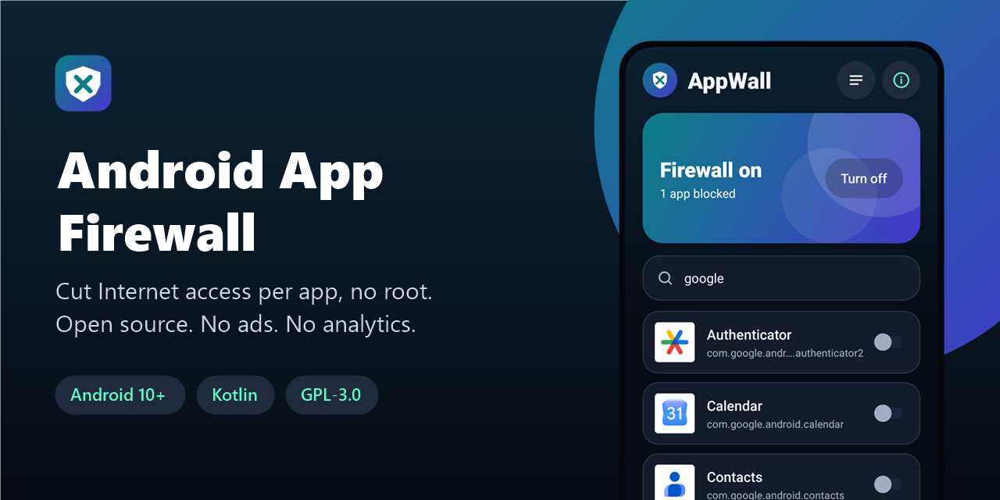
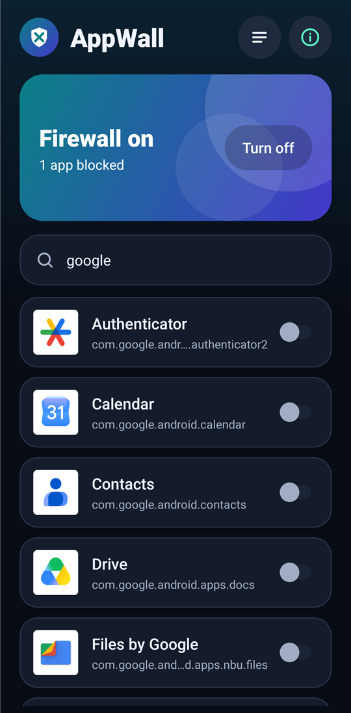
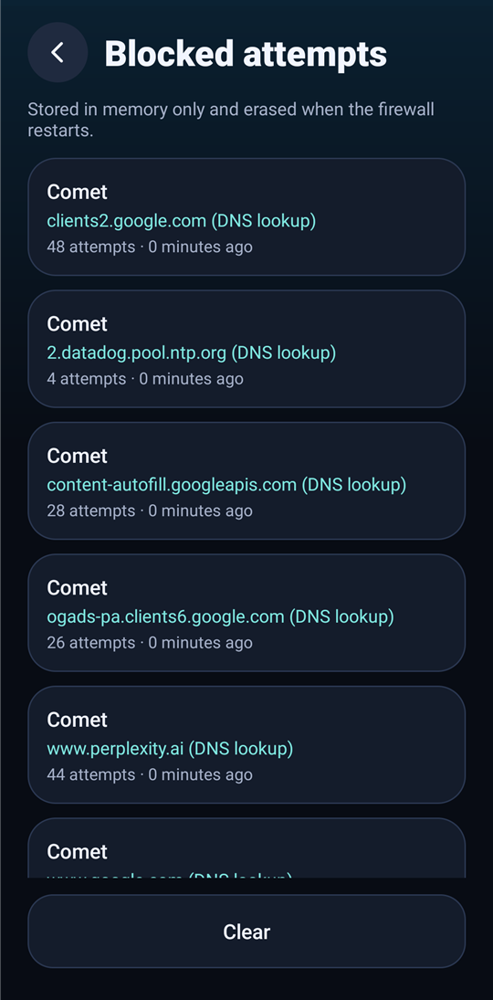
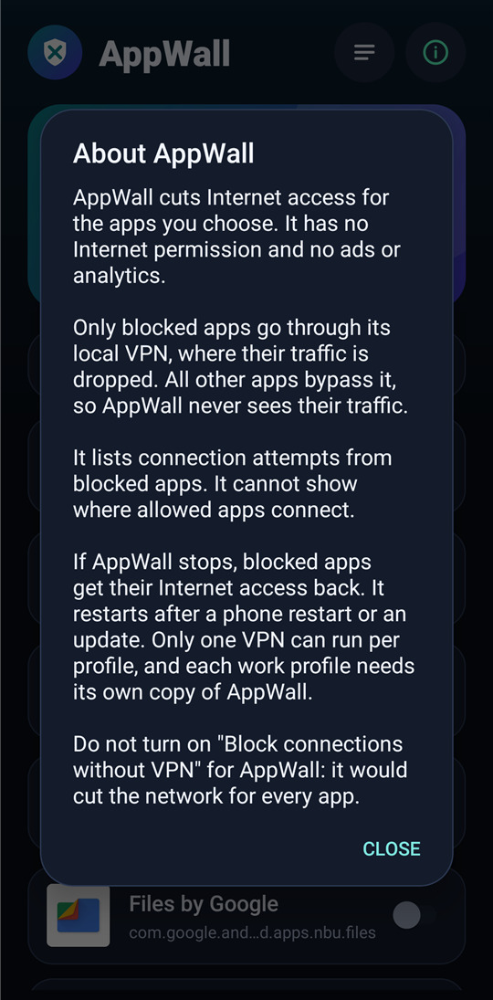

<div align="center">



# Android App Firewall

**Cut Internet access per app on Android, without root. Open source, no ads, no analytics.**

[](LICENSE)
[](#requirements)
[](https://kotlinlang.org)
[](#how-it-works)
[](app/build.gradle.kts)
[](app/src/main/AndroidManifest.xml)
[](https://github.com/Nekuzaky/android-app-firewall/stargazers)

</div>

Android App Firewall ships an app called **AppWall**. Choose the apps that should not reach the Internet, and AppWall drops their traffic through a local VPN. All other apps keep working normally and never pass through AppWall.

AppWall has no Internet permission, so it cannot send anything online itself.

## Screenshots

<p align="center">
  
  
  
</p>

## Features

- Block or allow each app with one switch, including while the firewall is on
- See connection attempts from blocked apps, with the app and the destination
- Search your installed apps
- Restart automatically after a phone restart or an app update
- Works inside a work profile when installed there
- No root, no account, no ads, no analytics and no third-party libraries

## How it works

AppWall uses the Android `VpnService` API, but it is not a VPN to a remote server.

1. The local VPN only includes the apps you block. Android keeps all other apps outside of it.
2. AppWall reads the packets of blocked apps from the tunnel, records the destination, then drops them.
3. Nothing is forwarded, so blocked apps get no connection and allowed apps are never seen.

This design is why AppWall needs no Internet permission.

## Privacy

- The list of blocked apps stays in the private storage of the app.
- Blocked attempts are kept in memory only and erased when the firewall restarts.
- AppWall does not see the traffic of allowed apps, so it cannot show where they connect.

### Permissions

| Permission | Why it is needed |
| --- | --- |
| `RECEIVE_BOOT_COMPLETED` | Turn the firewall back on after a phone restart |
| `BIND_VPN_SERVICE` | Held by Android only, so that only the system can bind the firewall service |

App visibility is limited to apps with a launcher icon through a `<queries>` declaration, instead of `QUERY_ALL_PACKAGES`.

## Requirements

- Android 10 (API 29) or later
- No other VPN running in the same profile
- JDK 21 and Android SDK 35 to build from source

Gradle 8.11 does not support the Java 25 runtime bundled with recent Android Studio versions, so use a separate JDK 21.

## Download

Download the signed APK from the [latest release](https://github.com/Nekuzaky/android-app-firewall/releases/latest) and open it on your phone. Android may ask you to allow installs from the app you opened it with.

The release notes list the SHA-256 checksum of the APK and of its signing certificate.

## Build from source

A build signed with your own key cannot install over the release APK. Uninstall the app first, which removes its rules.

```bash
git clone https://github.com/Nekuzaky/android-app-firewall.git
```

```bash
cd android-app-firewall
```

Create a `local.properties` file that points to your Android SDK:

```properties
sdk.dir=/path/to/Android/Sdk
```

Create a signing key, then add a `keystore.properties` file at the project root. It is ignored by Git, so never commit it or your key:

```properties
storeFile=/path/to/your-key.jks
storePassword=your-password
keyAlias=release
keyPassword=your-password
```

Build the release APK with JDK 21:

```bash
JAVA_HOME=/path/to/jdk-21 ./gradlew assembleRelease
```

Install it on a phone with USB debugging enabled:

```bash
adb install -r app/build/outputs/apk/release/app-release.apk
```

Run the unit tests:

```bash
JAVA_HOME=/path/to/jdk-21 ./gradlew testDebugUnitTest
```

## Usage

1. Open AppWall and tap the switch next to each app you want to block.
2. Tap **Turn on** and allow the VPN connection request from Android.
3. Open **Blocked attempts** to see what blocked apps try to reach.

Android shows a VPN icon while the firewall runs. This is expected: no traffic leaves your phone through AppWall.

## Limitations

- **Blocking stops when AppWall stops.** If the app is killed, blocked apps get their Internet access back.
- **Short gap after a restart.** On the test device, the firewall came back 30 to 60 seconds after startup, and blocked apps are not protected during that time.
- **Do not use "Block connections without VPN".** This Android setting would cut the network for every app that is not in the VPN.
- **One VPN per profile.** AppWall cannot run with another VPN in the same profile.
- **One copy per profile.** Rules apply to one profile only, so a work profile needs its own copy of AppWall.
- **System services are not covered.** An app can still get data through a service that runs under another identity, such as a system download service or push notifications.
- **Only apps with a launcher icon are listed.** Background-only apps cannot be selected.
- **Battery and manufacturer limits.** Some Android skins restrict background apps, which may stop the firewall or prevent its restart.
- **Changing the signing key is disruptive.** A build signed with a different key must replace the app, which erases its rules.

## Test status

Tested on one device: Oppo Reno4 Z 5G (CPH2065) with Android 12 and ColorOS.

| Scenario | Status |
| --- | --- |
| Block a browser, page stops loading | Works |
| Unblock while the firewall is on, page loads again | Works |
| Log attempts with the app and the destination | Works |
| Block an app inside a work profile | Works |
| Restart after an app update | Works |
| Restart after a phone restart, without opening the app | Works |
| Refuse an external attempt to stop the service from ADB | Works |
| Refuse an external launch of the log screen from ADB | Works |
| Parse malformed and random packets without crashing | Works, unit tests |
| Leave allowed apps unaffected over a long period | Not tested |
| Battery use | Not tested |
| Other phones and Android versions | Not tested |

Reports from other devices are welcome. Please open an issue with your phone model, Android version and the app you tried.

## Related

To run a second account of an app in a work profile, see [Android App Duplicator](https://github.com/Nekuzaky/android-app-duplicator). Copies made there need their own copy of AppWall to be blocked.

## License

Distributed under the [GNU General Public License v3.0](LICENSE).
